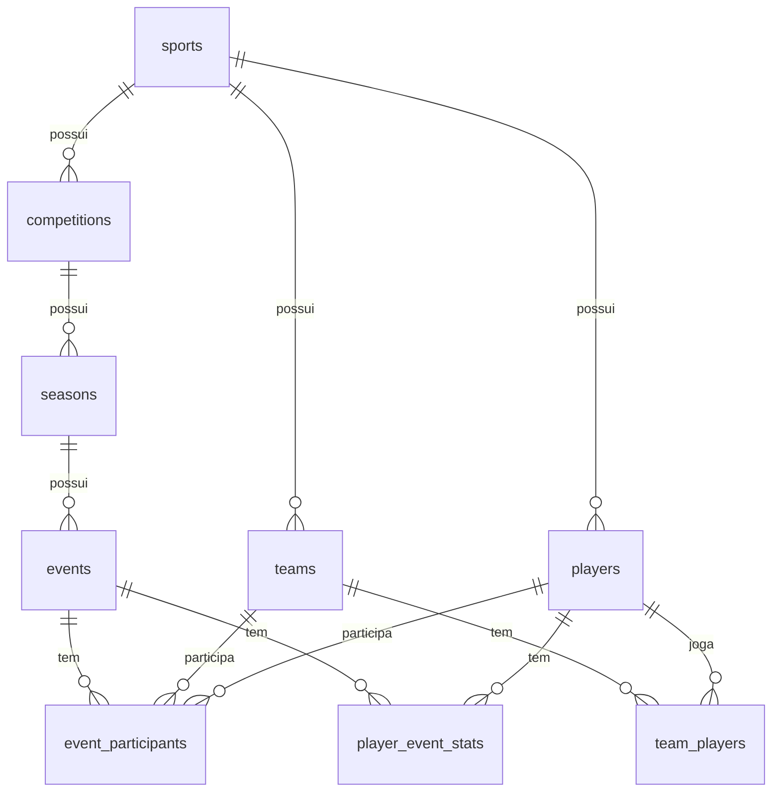

# Roadmap — Projeto Ágon

> Documento vivo. Registra o contexto do projeto, as decisões tomadas e o plano de evolução.
> Última atualização: 22/10/2026.

## Sumário

1. [Contexto e objetivo](#1-contexto-e-objetivo)
2. [Premissas](#2-premissas)
3. [Fontes de dados](#3-fontes-de-dados)
4. [Stack](#4-stack)
5. [Arquitetura](#5-arquitetura)
6. [Esboço do banco de dados](#6-esboço-do-banco-de-dados)
7. [Estrutura de pastas](#7-estrutura-de-pastas)
8. [Roadmap de versões](#8-roadmap-de-versões)
9. [Registro de decisões](#9-registro-de-decisões)
10. [Pendências e riscos](#10-pendências-e-riscos)

---

## 1. Contexto e objetivo

O **Projeto Ágon** é um hub centralizado para acompanhar vários esportes num só lugar: calendário de partidas, resultados, estatísticas de jogos e jogadores e, em versões futuras, placar ao vivo e notícias.

Ele tem dois objetivos:

- **Produto:** substituir a navegação entre vários sites e apps por um painel único com os esportes e campeonatos de interesse.
- **Aprendizado:** praticar e revisar desenvolvimento web completo (Python, TypeScript, HTML, CSS), banco de dados, integração com APIs, Docker e boas práticas de arquitetura.

### Esportes no escopo

| Esporte | Competições de interesse |
|---|---|
| Futebol | Brasileirão, Copa do Brasil, Libertadores, Sul-Americana, ligas europeias, Champions League, amistosos entre seleções |
| Basquete | NBA, seleções (FIBA); NBB como *nice to have* |
| Futebol americano | NFL |
| Tênis | ATP e WTA |
| Fórmula 1 | Temporada completa |
| Vôlei | Superliga (Brasil) e seleções |
| Olimpíadas | Jogos Olímpicos |

## 2. Premissas

- **Usuários:** cerca de 10 pessoas, sem acesso simultâneo relevante.
- **Hospedagem:** servidor próprio, com acesso remoto por túnel. Sem nuvem por enquanto, mas sem impedir uma migração simples no futuro.
- **Não transacional:** o sistema é de leitura. Não há pagamentos nem operações críticas de escrita por usuários.
- **Volume de dados:** estimativa de ~25 jogos por dia × até ~100 KB por jogo ≈ **2,5 MB/dia ≈ 1 GB/ano**, guardando inclusive o JSON bruto. É um volume pequeno para qualquer banco relacional. O gargalo real é a **cota de requisições** das APIs externas, não o armazenamento.
- **Histórico:** jogos encerrados são mantidos para sempre (dado frio e imutável). Jogos futuros e recentes são atualizados (dado quente).

## 3. Fontes de dados

### Como as APIs esportivas funcionam

- **REST + JSON:** requisições GET em endpoints que retornam JSON.
- **Chave de API:** token enviado em cada requisição, usado pelo provedor para contar o uso (nem todas exigem).
- **Cota e rate limit:** limite por dia e por minuto. Ao ultrapassar, a API devolve HTTP 429.
- **Hierarquia:** esporte → liga → temporada → jogo → estatísticas. Cada recurso tem um ID próprio do provedor.
- **Dois tipos de endpoint:** listagem (muitos jogos, pouco detalhe, barato) e detalhe (um jogo, estatísticas completas, uma requisição por jogo).
- **Origem dos dados:** provedores grandes (Sportradar, Stats Perform, Genius Sports) compram direitos oficiais das ligas. APIs grátis ou baratas revendem esses dados ou fazem scraping. Por isso dado esportivo de qualidade é caro.

### Fontes escolhidas

| Fonte | Papel | Cobertura | Custo / limites | Observações |
|---|---|---|---|---|
| **ESPN** (API não-oficial, `site.api.espn.com`) | **Primária** | Futebol (`bra.1`, `bra.copa_do_brazil`, `conmebol.libertadores`, `conmebol.sudamericana`, `uefa.champions`, ligas europeias, `fifa.friendly`), NBA, FIBA, NFL, tênis (ATP/WTA), F1 | Grátis, sem chave, sem cota declarada | Endpoints testados em 22/10/2026. Não é oficial nem documentada: pode mudar ou bloquear sem aviso, e o uso pode conflitar com os termos da ESPN. Aceitável para uso pessoal |
| **Jolpica-F1** | **Primária para F1** | Resultados, calendário e classificação desde 1950 | Grátis, sem chave, com rate limit | Sucessora compatível da Ergast |
| **API-Sports** (API-Football, API-Basketball, API-NBA, API-NFL, API-Volleyball) | **Fallback** e lacunas | Mais de 1.180 ligas de futebol, 115 de basquete, NFL, vôlei | Grátis: 100 req/dia **por esporte**. Pagos a partir de ~US$ 15–19/mês | Candidata para vôlei e NBB (cobertura a confirmar) |
| **OpenF1** | Complemento futuro | Telemetria, voltas, pit stops desde 2023 | Histórico grátis; tempo real pago | Útil para a v2 (ao vivo) |
| **football-data.org** | Alternativa | 12 competições no plano grátis | Grátis, 10 req/min, placar com atraso | Reserva caso ESPN e API-Football falhem |

Padrão de URL da ESPN:

```
https://site.api.espn.com/apis/site/v2/sports/{esporte}/{liga}/scoreboard?dates=AAAAMMDD
https://site.api.espn.com/apis/site/v2/sports/{esporte}/{liga}/summary?event={id}
```

### Lacunas conhecidas

| Lacuna | Situação | Plano |
|---|---|---|
| **Vôlei** (Superliga e seleções) | A ESPN só cobre vôlei universitário americano | Testar API-Volleyball (endpoint `/leagues`). Se não cobrir, scraper pontual do site da CBV/FIVB |
| **NBB** | A liga existe na ESPN (`basketball/nbb`), mas o calendário veio vazio | Testar API-Basketball |
| **Olimpíadas** | Não há API grátis ativa; só repositórios arquivados ou serviços pagos (Sportradar) | Reavaliar perto de Los Angeles 2028. Amistosos de futebol entre seleções já estão cobertos |
| **Tênis** (fallback) | Sem API oficial grátis e confiável além da ESPN | Avaliar Live Tennis API ou Matchstat se a ESPN falhar |

### Por que não construir uma API de dados própria

O sistema já terá uma **API própria sobre os provedores**: o backend coleta de várias fontes, normaliza e entrega ao frontend, que não sabe de onde o dado veio.

**Coletar os dados sem provedor não compensa.** Scraping quebra quando os sites mudam, esbarra em proteções anti-bot e termos de uso. Entrada manual é inviável no volume desejado, e dados oficiais são vendidos por contratos milionários. A exceção são **scrapers pontuais** para tapar lacunas específicas (ex.: Superliga), tratados como mais um adapter.

## 4. Stack

| Camada | Tecnologia | Motivo |
|---|---|---|
| Coleta (worker) | **Python** + `httpx` + **APScheduler** + **tenacity** | Linguagem de maior domínio; bom para tratar dados; agendamento e retry prontos |
| Backend (API) | **Python + FastAPI** | Mesma linguagem do worker, com código compartilhado; documentação automática em `/docs` |
| Banco | **PostgreSQL** + **SQLAlchemy** + **Alembic** | Suporte a JSONB, robusto, migrações versionadas |
| Frontend | **TypeScript + Vite + React** | Revisa TypeScript, HTML e CSS; padrão de mercado |
| Deploy | **Docker Compose** | Sobe tudo com um comando; migrar para VPS ou nuvem é copiar o compose |
| Acesso remoto | **Tailscale** (v1); Cloudflare Tunnel + Access (v4) | Sem abrir portas no roteador |

**Alternativa considerada para o frontend:** páginas renderizadas pelo FastAPI (Jinja2) + HTMX. É mais simples, mas treina menos TypeScript, então foi descartada para o objetivo de estudo.

## 5. Arquitetura

### Visão geral

```
┌──────────────────┐     ┌──────────────────────────────────────────┐
│ Fontes externas  │     │  Servidor (Docker Compose)               │
│                  │     │                                          │
│  ESPN            │     │  ┌────────────┐         ┌─────────────┐  │
│  Jolpica-F1      │◄────┼──┤  worker    ├────────►│ PostgreSQL  │  │
│  API-Sports      │     │  │  (coleta)  │ escreve │             │  │
│                  │     │  └────────────┘         └──────▲──────┘  │
└──────────────────┘     │                                │ lê      │
                         │                         ┌──────┴──────┐  │
                         │                         │  api        │  │
                         │                         │  (FastAPI)  │  │
                         │                         └──────▲──────┘  │
                         │                                │ JSON    │
                         │                         ┌──────┴──────┐  │
                         │                         │  frontend   │  │
                         │                         │  (React)    │  │
                         │                         └──────▲──────┘  │
                         └────────────────────────────────┼─────────┘
                                                          │ túnel
                                                     usuários
```

### Responsabilidades

- **worker:** busca dados nas fontes externas, normaliza e grava no banco. É o único que conhece as APIs externas e suas chaves.
- **api:** expõe os dados do banco em JSON para o frontend. É o único ponto de leitura do banco pelo usuário.
- **frontend:** telas de agenda, jogo, time e competição. Só conversa com a `api`.
- **PostgreSQL:** fonte da verdade do sistema.

**Um repositório e um código, rodando em dois processos** (`api` e `worker`), que compartilham modelos e acesso ao banco. Se a coleta travar, o site continua no ar, e vice-versa.

### Fluxo de dependências no código

```
providers → ingestion → repositories → banco ← repositories ← api ← frontend
```

- `providers` não sabem nada de banco.
- As rotas da `api` não sabem nada das fontes externas.

### Padrão adapter por provedor

Cada fonte externa fica isolada num módulo que implementa a mesma interface (ex.: `listar_jogos(liga, data)`, `detalhar_jogo(id)`) e devolve os dados já no formato interno. Trocar ou adicionar um provedor afeta só esse módulo.

### Jobs de coleta

| Job | Frequência | O que faz |
|---|---|---|
| **Calendário** | 1x por dia (ex.: 5h) | Busca jogos dos próximos ~7 dias; atualiza datas, horários e status |
| **Pós-jogo** | A cada 15–30 min | Busca estatísticas de jogos que já deveriam ter terminado e ainda não estão com status `final` |
| **Recuperação** | Ao iniciar o worker | Garante que nada ficou pendente enquanto o servidor estava desligado. O pós-jogo é baseado no estado do banco, então já se recupera sozinho |

### Tratamento de falhas

- **Retry com backoff exponencial** (`tenacity`) para erros 5xx e timeouts.
- **HTTP 429** (limite estourado): parar e tentar no próximo ciclo, sem insistir.
- **Upsert idempotente** pela referência externa (`INSERT ... ON CONFLICT DO UPDATE`). Rodar o mesmo job duas vezes não duplica dados.
- **Contador de requisições** por provedor e por dia, para respeitar cotas.
- **Fallback de provedor:** se a fonte primária falhar repetidamente, usar a secundária para aquele esporte.

### Observabilidade

- `logging` do Python com saída em stdout (logs ficam no Docker).
- Tabela `sync_runs` com o histórico de execuções dos jobs, exibida numa página de status da coleta.
- Futuro: aviso no Telegram ou ping no healthchecks.io quando um job falhar.

## 6. Esboço do banco de dados

### Princípios

- **Modelo híbrido:** tabelas **comuns** para o que todo esporte tem e coluna **JSONB** para estatísticas específicas de cada esporte.
- **Eventos com participantes:** um jogo de futebol tem 2 times, uma partida de tênis tem 2 jogadores, uma corrida de F1 tem ~20 pilotos. Por isso o placar fica na tabela de participantes, não em colunas `home`/`away`.
- **IDs internos próprios** + tabela de referências externas, para suportar vários provedores para a mesma entidade.
- **Guardar o JSON bruto** de cada resposta, para reprocessar sem gastar requisições.
- Quando uma estatística dentro do JSONB virar consulta frequente (ex.: artilharia), promovê-la a coluna ou tabela própria.

### Diagrama



### Tabelas

**Catálogo**

| Tabela | Colunas principais |
|---|---|
| `sports` | `id`, `slug` (football, basketball, nfl, tennis, f1, volleyball), `name` |
| `competitions` | `id`, `sport_id`, `name`, `country`, `type` (league, cup, tournament, race_series), `gender` |
| `seasons` | `id`, `competition_id`, `label` (ex.: "2026", "2025/26"), `start_date`, `end_date` |
| `teams` | `id`, `sport_id`, `name`, `short_name`, `country`, `is_national_team`, `logo_url` |
| `players` | `id`, `sport_id`, `name`, `nationality`, `birth_date`, `position`, `photo_url` |
| `team_players` | `team_id`, `player_id`, `season_id`, `shirt_number` (elenco por temporada) |

**Eventos**

| Tabela | Colunas principais |
|---|---|
| `events` | `id`, `sport_id`, `season_id`, `start_time` (UTC), `status` (scheduled, live, final, postponed, canceled), `round`, `venue`, `extra` JSONB |
| `event_participants` | `id`, `event_id`, `team_id` (nulo em esportes individuais), `player_id` (nulo em esportes coletivos), `side` (home, away ou nulo), `position` (colocação, para F1), `score`, `is_winner`, `stats` JSONB (estatísticas do time ou atleta no evento) |
| `player_event_stats` | `event_id`, `player_id`, `team_id`, `stats` JSONB (gols, rebotes, aces, voltas...) |

Exemplos de uso de `event_participants`:
- **Futebol:** 2 linhas com `team_id`, `side` = home/away, `score` = gols.
- **Tênis:** 2 linhas com `player_id`; os sets ficam em `stats`.
- **F1:** ~20 linhas com `player_id` (piloto), `team_id` (equipe) e `position`.

**Integração e operação**

| Tabela | Colunas principais |
|---|---|
| `external_refs` | `entity_type` (team, player, event...), `entity_id`, `provider`, `external_id`. Chave única em (`provider`, `entity_type`, `external_id`) |
| `raw_payloads` | `id`, `provider`, `endpoint`, `params` JSONB, `fetched_at`, `payload` JSONB |
| `sync_runs` | `id`, `job`, `provider`, `started_at`, `finished_at`, `status`, `requests_used`, `error` |

### Índices iniciais

- `events (start_time)` e `events (season_id, start_time)` para agenda.
- `event_participants (team_id)` e `(player_id)` para "jogos do meu time ou atleta".
- `external_refs (provider, entity_type, external_id)` único, para os upserts.

## 7. Estrutura de pastas

```
Projeto_Agon/
├── README.md
├── docker-compose.yml
├── .env.example            # modelo das variáveis (sem segredos)
├── documentacao/
│   └── ROADMAP.md
├── backend/
│   ├── pyproject.toml
│   ├── alembic/            # migrações do banco
│   ├── app/
│   │   ├── core/           # config, logging, conexão com o banco
│   │   ├── models/         # tabelas (SQLAlchemy)
│   │   ├── schemas/        # formatos de entrada/saída (Pydantic)
│   │   ├── repositories/   # consultas ao banco
│   │   ├── providers/      # adapters de cada fonte externa
│   │   │   ├── base.py
│   │   │   ├── espn.py
│   │   │   ├── jolpica.py
│   │   │   └── api_sports.py
│   │   ├── ingestion/      # jobs: calendário, pós-jogo, recuperação
│   │   ├── api/            # rotas FastAPI
│   │   ├── main_api.py     # entrypoint do processo api
│   │   └── main_worker.py  # entrypoint do processo worker
│   └── tests/
└── frontend/
    ├── package.json
    └── src/
        ├── api/            # cliente que chama o backend
        ├── components/     # peças reutilizáveis (card de jogo, tabela)
        ├── pages/          # telas: agenda, jogo, time, competição
        └── types/          # tipos TS das respostas
```

## 8. Roadmap de versões

### v0 — Exploração
- [ ] Inspecionar no navegador as respostas da ESPN (`scoreboard` e `summary`) de um jogo encerrado do Brasileirão.
- [ ] Criar conta grátis na API-Sports e testar a cobertura de vôlei (Superliga, VNL) e NBB.
- [ ] Ajustar o esboço do banco com base nos formatos reais.

### v1 — Fundação (futebol)
Objetivo: validar o fluxo completo **coleta → banco → API → tela** com um esporte.
- [ ] Docker Compose com PostgreSQL, `api`, `worker` e `frontend`.
- [ ] Modelos e migrações do banco (Alembic).
- [ ] Adapter ESPN para futebol.
- [ ] Jobs de calendário e pós-jogo, com retry, upsert idempotente e `sync_runs`.
- [ ] Rotas: agenda por data, detalhe do jogo, jogos por time, competições.
- [ ] Telas: agenda, detalhe do jogo com estatísticas, página do time.
- [ ] Chave de API e credenciais em `.env` fora do Git (custo zero, já na v1).
- [ ] Acesso remoto via Tailscale (sem expor o túnel publicamente).

### v1.1 — Mais esportes
- [ ] NBA, FIBA, NFL e tênis via ESPN.
- [ ] F1 via Jolpica (calendário, resultados, classificação).
- [ ] Formatos de `stats` JSONB por esporte e telas adaptadas.

### v1.2 — Lacunas e resiliência
- [ ] Vôlei: API-Volleyball ou scraper pontual da CBV/FIVB.
- [ ] NBB via API-Basketball.
- [ ] Fallback automático para API-Sports quando a ESPN falhar.
- [ ] Página de status da coleta.

### v2 — Ao vivo
- [ ] Job de polling (~30 s) apenas para jogos com status `live`.
- [ ] **Server-Sent Events** da `api` para o navegador (o dado só vai do servidor ao cliente, então SSE basta).
- [ ] Avaliar OpenF1 para dados de corrida em tempo real.
- [ ] Confirmar antes se as cotas das fontes aguentam o polling.

### v3 — Notícias
- [ ] Coletor de feeds RSS (ge, ESPN, etc.).
- [ ] Guardar título, resumo, link, fonte e data; nunca o texto completo (direitos autorais).
- [ ] Associar notícias a esportes, competições e times.
- [ ] Feed de notícias por time ou esporte.

### v4 — Segurança e usuários
- [ ] Cloudflare Tunnel + Cloudflare Access (login antes de chegar ao servidor), ou manter Tailscale.
- [ ] Login próprio com sessões/cookies no backend.
- [ ] Preferências por usuário (times e esportes favoritos), com agenda e notícias personalizadas.
- [ ] HTTPS de ponta a ponta.
- [ ] Rate limit na API própria.
- [ ] Backups automáticos do banco.

### Futuro
- [ ] Olimpíadas: avaliar fontes perto de Los Angeles 2028.
- [ ] Redis para cache das rotas mais acessadas.
- [ ] Deploy em VPS ou nuvem, reaproveitando o Docker Compose.
- [ ] Alertas de falha da coleta (Telegram, healthchecks.io).

## 9. Registro de decisões

| # | Data | Decisão | Motivo |
|---|---|---|---|
| 1 | 22/10/2026 | ESPN (não-oficial) como fonte primária | Cobre ~80% do escopo, grátis e sem cota; risco mitigado pelo padrão adapter |
| 2 | 22/10/2026 | Jolpica-F1 para Fórmula 1 | Grátis, histórico completo, sucessora da Ergast |
| 3 | 22/10/2026 | API-Sports como fallback e para lacunas | API oficial com plano grátis e ampla cobertura |
| 4 | 22/10/2026 | Não construir coleta própria do zero | Custo de manutenção alto; scrapers só para lacunas pontuais |
| 5 | 22/10/2026 | Python + FastAPI no backend e no worker | Linguagem de maior domínio; código compartilhado |
| 6 | 22/10/2026 | TypeScript + Vite + React no frontend | Objetivo de estudo de TypeScript |
| 7 | 22/10/2026 | PostgreSQL com modelo híbrido (tabelas comuns + JSONB) | Volume pequeno; consultas entre esportes simples; esporte novo sem tabela nova |
| 8 | 22/10/2026 | Eventos com tabela de participantes | Suporta esportes coletivos, individuais e corridas no mesmo modelo |
| 9 | 22/10/2026 | Guardar JSON bruto das respostas | Reprocessar sem gastar cota |
| 10 | 22/10/2026 | Um repositório, dois processos (`api` e `worker`) | Isolamento de falhas sem duplicar código |
| 11 | 22/10/2026 | Docker Compose em servidor próprio | Simples hoje, migrável para nuvem amanhã |
| 12 | 22/10/2026 | Ao vivo na v2, notícias na v3, segurança na v4 | Foco da v1 em partidas e estatísticas pós-jogo |

## 10. Pendências e riscos

| Item | Tipo | Ação |
|---|---|---|
| ESPN pode mudar ou bloquear a API sem aviso | Risco | Adapter isolado + fallback para API-Sports |
| Termos de uso da ESPN | Risco | Manter uso pessoal e privado |
| Cobertura de vôlei e NBB não confirmada | Pendência | Testar API-Sports na v0 |
| Olimpíadas sem fonte grátis | Pendência | Reavaliar perto de 2028 |
| Rate limits reais da Jolpica e da API-Sports | Pendência | Confirmar na documentação oficial antes da v1.1 |
| Túnel exposto sem autenticação na v1 | Risco | Usar Tailscale até a v4 |

## Referências

- [ESPN hidden API guide (Zuplo)](https://zuplo.com/learning-center/espn-hidden-api-guide)
- [Jolpica-F1 (docs FastF1)](https://docs.fastf1.dev/api_reference/jolpica.html)
- [OpenF1 (GitHub)](https://github.com/br-g/openf1)
- [API-Football: guia de início](https://www.api-football.com/news/post/how-to-get-started-with-api-football-the-complete-beginners-guide)
- [API-NBA: guia de início](https://www.api-football.com/news/post/how-to-get-started-with-api-nba-the-complete-beginners-guide)
- [API-NFL: guia de início](https://www.api-football.com/news/post/how-to-get-started-with-api-nfl-the-complete-beginners-guide)
- [football-data.org: limites do plano grátis (fonte de terceiros)](https://www.thestatsapi.com/blog/football-data-org-free-tier-limits-2026)
